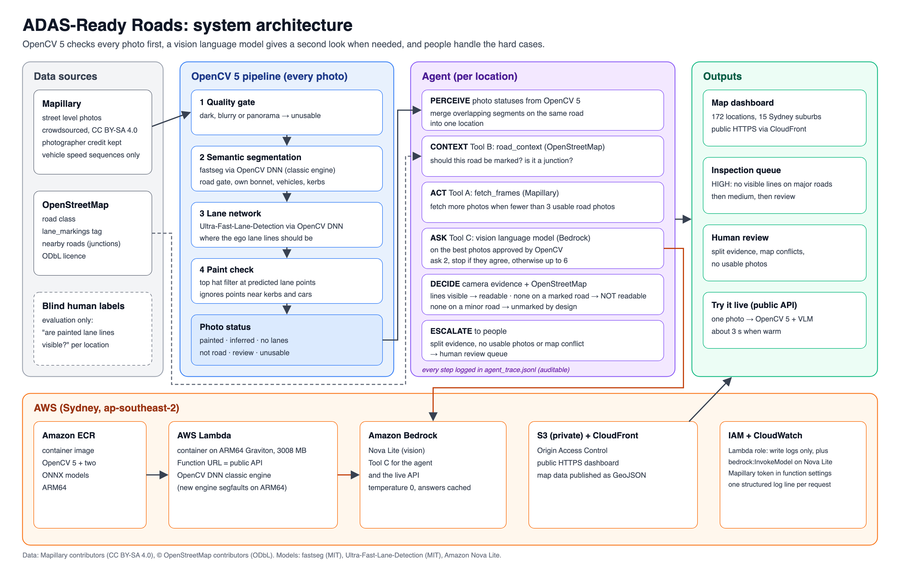

# ADAS-Ready Roads

**Can a camera based lane keeping system see the painted lane lines on this road?**

ADAS-Ready Roads is an agent that screens Sydney streets for lane marking visibility. It uses
crowdsourced street level imagery (Mapillary), **OpenCV 5**, OpenStreetMap context and a vision
language model (VLM) on **Amazon Bedrock**, and it routes uncertain places to people.
It is built for councils that want to know where driver assist cameras may struggle,
without sending out survey vehicles.

> **Research prototype.** Verdicts are screening hints to prioritise human inspection, not
> safety certifications. The evaluation below states what has and has not been demonstrated.

* **Live dashboard:** https://d1dzzj0gvxxl4o.cloudfront.net (start with the **Quick tour** box at the top)
* **Live API (AWS Lambda Function URL):** https://unft6yl7d6znbr6gvfvqbwzqmq0tidph.lambda-url.ap-southeast-2.on.aws/
  Opening it in a browser shows how to use it and **what is running**: OpenCV version, DNN engine,
  both ONNX models with fingerprints, and the git commit. To analyse a photo, send a POST request:
  `curl -X POST https://unft6yl7d6znbr6gvfvqbwzqmq0tidph.lambda-url.ap-southeast-2.on.aws/ -H 'content-type: application/json' -d '{"mapillary_id": "1043027243798906"}'`
* **Technical report:** [docs/technical_report.pdf](docs/technical_report.pdf)
* Entry for the OpenCV AI Competition 2026 (powered by AWS): **Overall** and the **Agentic Vision Award**.
  Best Use of COOL is not entered, because this project does not use COOL.

---

## Results at a glance

**Latest clean test: 96% agreement (kappa 0.80) on 88 new locations, labelled blind; no road without lines called readable.**

Every location is checked against one question: *are painted lane lines visible?*
Ground truth comes from blind human labels.

| Evaluation | Locations | Lines visible, confirmed | No lines, found |
|---|---|---|---|
| First clean test, 4 unseen suburbs (frozen v5) | 56 | **42 of 48 decided = 88%** (95% CI 75 to 94%) | 0 of 1 (only one such road) |
| Final set, 5 suburbs (reused, disclosed) | 48 | 31 of 38 = 82% | 4 of 7 |
| Development suburbs | 29 | 17 of 19 = 89% | 5 of 8 |
| Missing markings test: Paddington, Oran Park, Marsden Park, Smithfield | 60 | 37 of 37, 100% | 11 of 19, 58% |
| Clean test 2: Jordan Springs, Gregory Hills, Box Hill, Leppington | 88 | 65 of 68, 96% | 7 of 7, none called lines visible |
| **Pooled** | 281 | **192 of 210, about 91%** | **27 of 42, about 64%** |

* About 1 in 10 locations goes to human review instead of being guessed.
* **Missing markings: promising, few examples.** On the latest clean test no road without lines was called "lines visible" (7 found, 6 sent to review). Across all tests 27 of 42 unmarked locations were found.
* Earlier versions that used OpenCV alone (a hand built paint detector, then a lane network with
  a paint check) scored **at chance** on unseen suburbs: 44% with kappa −0.01 on the 48 location
  set, where v5 reaches 78% with kappa 0.31.
* OpenStreetMap alone is a poor guide (54% on the 48 location set).
* Human self agreement on **paint wear** was poor (kappa 0.14 over two blind passes), so the
  system does **not** grade wear. It answers the measurable question of visibility instead.

Full numbers, protocol and history: `notes/final_evaluation.md` and the `eval_*.txt` files.

---

## How it works

~~~
Mapillary photos (CC BY-SA)                         OpenStreetMap (ODbL)
        |                                                   |
        v                                                   |
 OpenCV 5 pipeline (every photo)                            |
   quality gate (dark, blurry, panorama)                    |
   fastseg semantic segmentation (OpenCV DNN):              |
     road gate, own bonnet removal, vehicles                |
   Ultra-Fast-Lane-Detection (OpenCV DNN) + paint check     |
        |                                                   |
        v                                                   v
 Agent (per location)  PERCEIVE → CONTEXT → ACT → ASK → DECIDE → ESCALATE
   * vehicle speed filter (drops walking and handheld sequences)
   * merges overlapping segments on the same road into one location
   * ACT: fetches more Mapillary photos when fewer than 3 usable road photos exist
   * ASK: Tool C, Amazon Bedrock (Nova Lite), on the best photos approved by OpenCV,
          adaptively: ask 2, stop if they agree, otherwise up to 6 (about 2.4 per location)
   * DECIDE with OSM: lines visible → readable | no lines on a marked road → NOT readable
                      (HIGH priority on major roads) | no lines on a minor road → unmarked
   * ESCALATE: split evidence, no usable photos or a map conflict → human review
   * every step is logged to *_agent_trace.jsonl; every photo and answer to *_agent_frames.csv
        |
        v
 AWS: Lambda (container, ARM64 Graviton, Sydney) → live single photo API
      S3 (private) + CloudFront (Origin Access Control) → public dashboard
      IAM least privilege: logs only, plus bedrock:InvokeModel on Nova Lite only
~~~

One agent decision, step by step (`make trace`, location L0015, Waratah Lane):

~~~
1. PERCEIVE  OpenCV 5 checked 4 photos: 2 usable road photos, paint confirmed in 0%
2. CONTEXT   OpenStreetMap: Waratah Lane (service), expected to be marked: False, junction: False
3. ACT       Too few road photos, so fetched 8 more within 44 m: road photos 2 -> 8
4. ASK       Asked the vision model about 2 of 8 photos: 2 yes, 0 no, so stopped early
5. DECIDE    adas_readable: painted lane lines visible (2/2 photos) (priority: none)
~~~

### Why a vision language model?
Three approaches using OpenCV alone were built and honestly tested on unseen suburbs, and all
scored at chance (see History). The evaluation target, "are painted lines visible?", is a human
visual judgement, and a VLM matched blind human labels far better (development probe: 96%,
kappa 0.84 on consistently labelled locations). OpenCV 5 stays the first stage.

### What OpenCV contributes, measured
Two experiments measured the OpenCV stage on top of the VLM, with the same photos, labels and rules:

| Experiment | Result |
|---|---|
| Gate ablation (`ablation_gate.py`): every photo goes to the model, no OpenCV filtering | Clean test 82% vs 86% gated; final set 75% vs 78% (balanced 72% vs 69%). Without the gate, 5% and 12% of calls went to photos OpenCV rejects |
| Road focus probe (`crop_probe.py`): model sees only the segmented road, or the road with the rest greyed out | Balanced 77% (crop) and 74% (grey) vs 78% for the full photo, on 72 development locations. Not adopted (a +5 point rule was fixed in advance) |

So in v5 OpenCV decides when the agent fetches more evidence, chooses which photos the model sees
and avoids wasted calls; its effect on final accuracy is small. The model judges best with the
whole scene.

### OpenCV 5 findings
* **The new OpenCV 5 DNN engine segfaults** on both ONNX models on Linux ARM64 (AWS Lambda),
  reproducibly at `net.forward()`, and crashed intermittently on macOS. The **classic engine**
  (`cv.dnn.readNetFromONNX(path, engine=cv.dnn.ENGINE_CLASSIC)`) is stable. Verdicts from the
  classic and new engines agreed on 318 of 320 photos (`compare_engines.py`).
* The output shape of `HoughLinesP` changed from 4.x; this is handled with `reshape(-1, 4)`.

---

## Tests

~~~bash
pip install -r requirements.txt -r requirements-dev.txt
make check     # 33 tests, offline, about 1 second
make trace     # prints the Waratah Lane agent trace
~~~

| Test file | What it checks |
|---|---|
| `tests/test_quality.py` | OpenCV quality gate (dark, blurry, panorama), resizing, own bonnet detection |
| `tests/test_segments.py` | Distances, speeds and the walking filter, segment splitting, verdict thresholds |
| `tests/test_agent.py` | Agent decisions: stops after two matching answers, fetches only when evidence is thin, never sends rejected photos to the model, routes split answers and map conflicts to people, flags major roads as high priority |
| `tests/test_eval_maths.py` | Confidence intervals (reproduces the reported 75 to 94%), kappa, balanced accuracy |
| `tests/test_handler.py` | API: usage guide and runtime section, bad input rejected, unusable photos never reach Bedrock (skipped if model files are absent) |

---

## Repository guide

| File | Purpose |
|---|---|
| `adas_pipeline.py` | OpenCV 5 pipeline per photo, v4 (quality, segmentation, lane network and paint check) |
| `lane_features.py` | Ultra-Fast-Lane-Detection wrapper and paint verification |
| `agent.py` | Location agent v5 (perceive, context, fetch, ask the VLM, decide, escalate, traces) |
| `agent_tools.py` | Tool A `fetch_frames` (Mapillary) and Tool B `road_context` (OSM Overpass, cached) |
| `vlm_tool.py` | Tool C: Amazon Bedrock Nova Lite, "are painted lane lines visible?" (cached) |
| `segments.py` | Vehicle speed filter, segments of about 100 m, summary per segment |
| `run_pipeline.py` | Runs the pipeline over `<data>/<area>/*.jpg` |
| `fetch_mapillary.py` | Downloads images and metadata (including photographer credit) for a bounding box |
| `handler.py`, `Dockerfile` | AWS Lambda endpoint for single photos (OpenCV 5 and Bedrock), with runtime info |
| `dashboard/` | Static map dashboard (Leaflet) with the Quick tour, hosted on S3 and CloudFront |
| `show_trace.py` | Prints one location's agent trace as readable steps |
| `ablation_gate.py`, `road_focus.py`, `crop_probe.py` | Experiments on what the OpenCV stage contributes |
| `view_segments.py`, `label_binary.py`, `label_locations.py` | Contact sheets and blind labelling tools |
| `evaluate_binary.py`, `evaluate_locations.py`, `label_agreement.py`, `remap_labels.py` | Evaluation, label reliability and label mapping |
| `export_seg.py`, `export_ufld.py` | One time ONNX export of the two models |
| `tests/`, `Makefile`, `pytest.ini` | Automated tests (`make check`) |
| `notes/` | Failure analyses and the full evaluation log |

---

## Run it yourself

**1. Setup** (macOS or Linux, Python 3.12 or newer):
~~~bash
python -m venv .venv && source .venv/bin/activate
pip install -r requirements.txt -r requirements-dev.txt
~~~

**2. Models** (not in git; see licences below):
~~~bash
pip install -r requirements-export.txt
python export_seg.py           # creates models/fastseg_large_512x1024.onnx
# Ultra-Fast-Lane-Detection: clone https://github.com/cfzd/Ultra-Fast-Lane-Detection to ../ufld,
# download culane_18.pth from that README into models/, then:
python export_ufld.py          # creates models/ufld_culane18_288x800.onnx (loaded with weights_only=True)
~~~

**3. Credentials:** a Mapillary token in `MAPILLARY_TOKEN`, and AWS credentials with Bedrock
access (`aws login --region ap-southeast-2`) for the VLM tool.

**4. Fetch photos, analyse them, run the agent:**
~~~bash
python fetch_mapillary.py kensington 151.215 -33.925 151.230 -33.910 data 100
python run_pipeline.py data output_main
python agent.py output_main/results.csv main_
python view_segments.py --prefix main_ all            # annotated contact sheets
~~~
Outputs: `main_segments_agent.csv` and `.geojson`, `main_review_queue.csv`,
`main_agent_trace.jsonl`, `main_agent_frames.csv`.

**5. Deploy** (summary): build the container
(`docker build --platform linux/arm64 --provenance=false --sbom=false --build-arg GIT_COMMIT=$(git rev-parse --short HEAD)`)
and push it to ECR. Create a Lambda (ARM64, 3008 MB, 60 s) from the image, with a role that has
`AWSLambdaBasicExecutionRole` plus `bedrock:InvokeModel` on Nova Lite only. Add a Function URL with
both `lambda:InvokeFunctionUrl` and `lambda:InvokeFunction` (`--invoked-via-function-url`). Host
`dashboard/` in a private S3 bucket behind CloudFront with Origin Access Control.

---

## History: what was tried, and what the tests said

| Version | Idea | Honest result |
|---|---|---|
| v0 to v3c | Hand built OpenCV paint detector (top hat, Hough, contrast) with segmentation | Overfit the development data; locked test had 7 of 17 dangerous misses; location test on fresh suburbs 42% |
| v4 | Ultra-Fast-Lane-Detection (OpenCV DNN) with paint verification | Final test 44%, kappa −0.01 (chance) |
| v5 | VLM tool on Bedrock gated by OpenCV, adaptive evidence, OSM | First clean test: 88% of lined locations confirmed. Clean test 2: 96% agreement, kappa 0.80; no unmarked road called readable |
| Later experiments | OpenCV gate ablation; road focus crop for the VLM | Gate saves wasted calls, small accuracy effect; crop did not help and was not adopted |

Protocol: thresholds were tuned on development data only; each test set was used once (reuse is
disclosed); labels were blind; contact sheets were generated from the exact run being evaluated;
label reliability was measured with a second blind pass; rules for adopting a change were fixed
before the experiment ran.

---

## Limitations and responsible use
* Screening only. Never a substitute for an on site inspection or a safety assessment.
* Missing marking detection rests on few unmarked roads (42 across all tests, one labeller).
* Labels come from a single labeller, and wear cannot be judged reliably from crowd photos.
* The OpenCV stage's measured effect on final accuracy is small; the VLM makes the visual judgement.
* Crowd imagery is uneven in time, camera, weather and coverage; results reflect when photos were taken.
* OpenStreetMap lookups can fail under server load (disclosed for each evaluation).
* Photographer credit and licence are kept with every photo; no images are stored in the repository.

## Credits and licences
* Street imagery: Mapillary contributors, CC BY-SA 4.0 (creator recorded for each photo).
* Road data and map tiles: © OpenStreetMap contributors, ODbL.
* fastseg MobileV3Large (MIT), weights trained on Cityscapes.
* Ultra-Fast-Lane-Detection, Qin et al., ECCV 2020 (MIT), weights trained on CULane.
* Amazon Nova Lite via Amazon Bedrock.
* Built with OpenCV 5, AWS Lambda, ECR, S3, CloudFront, IAM and Bedrock.

Author: Anna Rose Bijoy, Master of IT (AI), UNSW Sydney.

## Missing markings test (14 Oct 2026)

Four suburbs picked in advance for new estates and narrow streets, where unmarked roads are common: Paddington, Oran Park, Marsden Park and Smithfield. Frozen v5, labelled blind, evaluated once.

| Measure | Result |
|---|---|
| Locations | 60 (583 photos) |
| Agreement (decided) | 48 of 56, 86% (95% CI 74 to 93%) |
| Cohen's kappa | 0.65 |
| Balanced accuracy | 79% (always yes 50%, OpenStreetMap only 56%) |
| Lines visible, confirmed | 37 of 37 (100%) |
| No lines, found | 11 of 19 (58%) |
| Sent to review | 4, of which 3 had no lines |

All 8 errors were roads without lines called "lines visible". Pooled across the tests up to this point: lines confirmed 127 of 142 (about 89%), no lines found 20 of 35 (about 57%).

The public Overpass servers stopped answering during this run, so 32 of 86 segments ran without OpenStreetMap context (`run_agent_cached_osm.py`). OSM does not change the verdict in v5. `agent_tools.py` now rotates across Overpass servers with a 60 s limit per location. Full log: `notes/final_evaluation.md`. Results: `eval_final3_segments_agent.txt`.

## Second labelling pass and clean test 2 (14 Oct 2026)

Error analysis of the missing markings test showed that most "misses" were sheets with painted lines, labelled quickly in a small window. Correcting only those would bias the result, so all 60 were relabelled in a second, shuffled, full screen pass: it agreed with the first on 52 of 60 (kappa 0.69), every change was from no to yes, and against it the system was right on 55 of 56 (98%, kappa 0.95). This pass is not fully blind (7 changed sheets had been seen during error analysis), so the first pass stays the reported blind result. One real error remained, so v5 was not changed.

Clean test 2 then used four new growth suburbs chosen before fetching, the full screen labeller (`label_binary.py`, key `z` zooms) and the unchanged v5:

| Measure | Result |
|---|---|
| Locations | 88 (437 photos) |
| Agreement (decided) | 72 of 75, 96% (95% CI 89 to 99%) |
| Cohen's kappa | 0.80 |
| Balanced accuracy | 98% (always yes 50%) |
| Lines visible, confirmed | 65 of 68 |
| No lines | 7 found, 6 sent to review, none called lines visible |
| Sent to review | 13 of 88 |

OpenStreetMap was skipped in this run (`run_agent_cached_osm.py`) because the public servers were unreliable; the verdict does not use it. Results: `eval_final4_segments_agent.txt`, `eval_final3_pass2.txt`.

